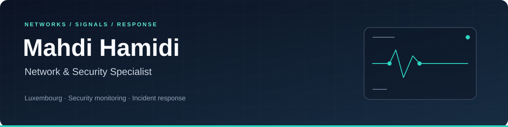

  <a href="https://www.linkedin.com/in/mahdi-hamidi-3a0307163/">LinkedIn</a> &nbsp;·&nbsp;
  <a href="https://resume-v2-six-iota.vercel.app/">Résumé</a> &nbsp;·&nbsp;
  <a href="mailto:info.busitech@proton.me">Email</a> &nbsp;·&nbsp;
  <a href="https://github.com/busitech-ir-lux/dlh-cyber_security">Cybersecurity portfolio</a>

## Networks are my foundation. Defence is my focus.

I'm **Mahdi**, a network and security professional based in **Luxembourg**, with **5+ years in IT** spanning ISP support, enterprise IT, and network security in healthcare environments.

I've worked with Fortinet firewalls and FortiAnalyzer, administered endpoint protection for **300+ endpoints**, and managed networks and access across Cisco, MikroTik, and Active Directory. Reviewing logs, validating alerts, and resolving operational incidents are the parts of that work I'm building on today.

My current focus is **security monitoring and incident response**, supported by hands-on Blue Team coursework and a part-time **Master's in Information System Security Management** at the **University of Luxembourg**.

## What I bring

| Operational experience | Current technical focus |
| --- | --- |
| Firewall administration and network troubleshooting | Log analysis, detection engineering, and alert triage |
| Endpoint protection operations and response actions | SOC playbooks and investigation workflows |
| Active Directory provisioning and access management | Identity security and privileged access review |
| Enterprise support in healthcare environments | Evidence handling and clear security reporting |

## Selected work

My [DLH Cyber Security Academy portfolio](https://github.com/busitech-ir-lux/dlh-cyber_security) documents **seven months of coursework** across defensive engineering, threat detection, incident response, and governance. The **capstone project is in progress**. The projects below are coursework and simulated investigations, with their scope and limitations documented in the repository.

<table>
<tr>
<td width="50%" valign="top">

### Detection engineering

Sigma rules for authentication, execution, persistence, and correlated activity, alongside detection quality and prioritisation work.

**Sigma · ATT&amp;CK · Event analysis**

<a href="https://github.com/busitech-ir-lux/dlh-cyber_security/tree/main/blue_team/3x02_the_alert_factory">Explore the detection lab →</a>

</td>
<td width="50%" valign="top">

### SOC automation

A local prototype for indicator enrichment, case management, and phishing and credential triage, with isolation recommendations queued for human authorisation.

**Python · SQLite · Response playbooks**

<a href="https://github.com/busitech-ir-lux/dlh-cyber_security/tree/main/grc/6x03_soc_playbook">Explore the automation project →</a>

</td>
</tr>
<tr>
<td width="50%" valign="top">

### Incident response &amp; evidence

Containment playbooks, chain-of-custody documentation, investigation timelines, and forensic reporting with explicit evidence limitations.

**DFIR · Evidence handling · Reporting**

<a href="https://github.com/busitech-ir-lux/dlh-cyber_security/tree/main/ir_dfir_playbook">Explore the response portfolio →</a>

</td>
<td width="50%" valign="top">

### Identity &amp; access security

Account auditing, IAM policy analysis, federation, and privileged access exercises connecting technical findings to practical remediation.

**IAM · SAML · Privileged access**

<a href="https://github.com/busitech-ir-lux/dlh-cyber_security/tree/main/grc/6x02_iam_scale">Explore the identity lab →</a>

</td>
</tr>
</table>

## Tools I work with

**Operations:** firewall and syslog analysis, Kaspersky Security Center / KES, endpoint response, and network troubleshooting.  
**Lab work:** Python, Bash, PowerShell, Wireshark, Sigma, and security investigation documentation.

## Currently

- Studying Information System Security Management at the University of Luxembourg, **part-time**.
- Developing my defensive security portfolio and completing the academy **capstone project**.
- Interested in **SOC, security monitoring, incident response, and network security opportunities** in Luxembourg.

**Available for full-time work · Authorised to work in Luxembourg**  
English: advanced · French: A1, learning

---

  <strong>Let's connect.</strong> 
  <a href="mailto:info.busitech@proton.me">info.busitech@proton.me</a> &nbsp;·&nbsp;
  <a href="https://www.linkedin.com/in/mahdi-hamidi-3a0307163/">LinkedIn</a>

